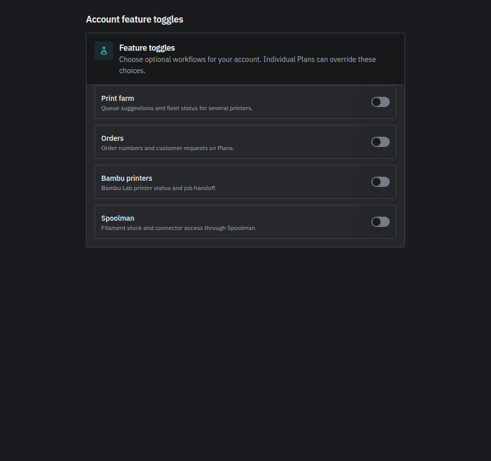
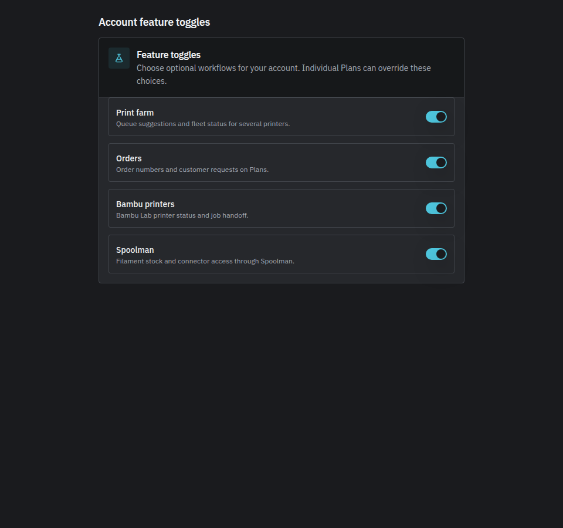
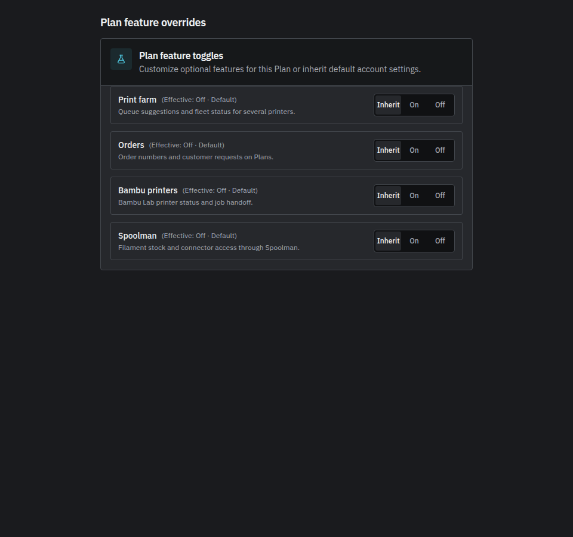
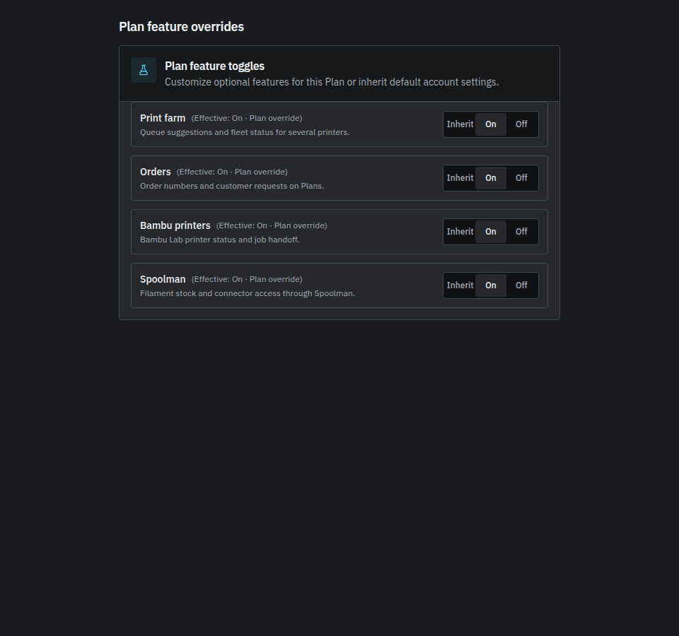
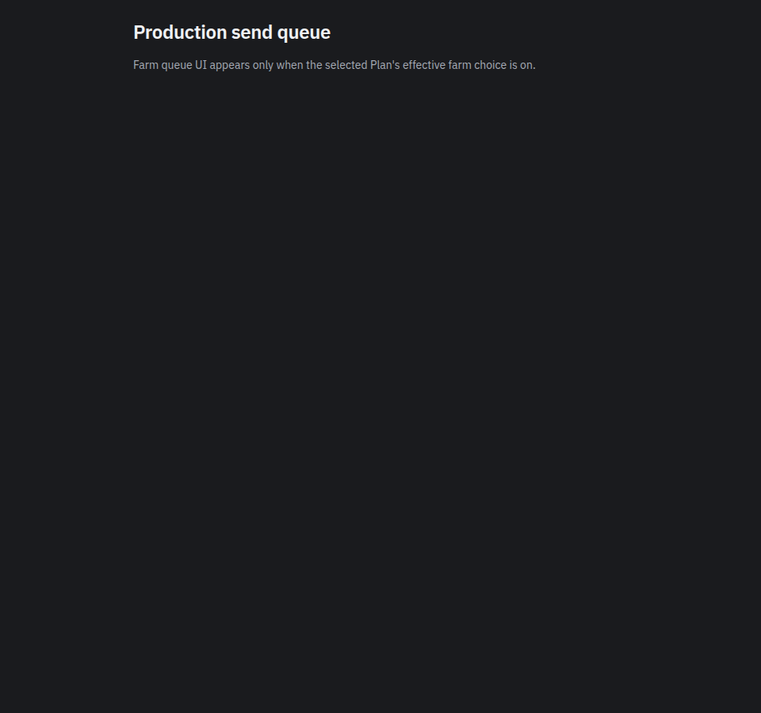
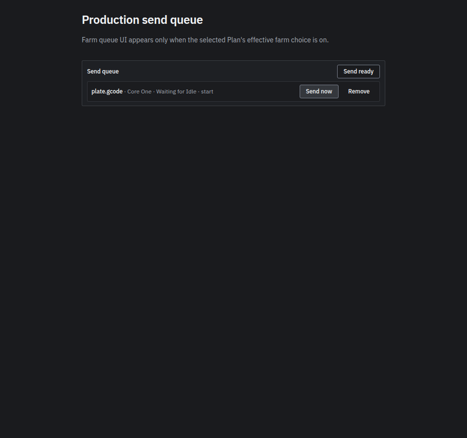

# GRE-498 feature toggle proof pack

Parent ticket [GRE-498](https://linear.app/greetz/issue/GRE-498) requires tests per feature
and verify screenshots for the **default** UI (all four optional modules off) versus a
**fully enabled** account and Plan. This document indexes the committed proof artifacts
on `main`. It is a **Refs** slice; it does not close GRE-498 (no `Fixes GRE-498`).

Ground rules:

- Requires `PP_DESKTOP_REBUILD` and the `tenant_feature_toggles` capability (see
  [desktop rebuild](../desktop-rebuild.md)).
- Fresh tenants keep farm, orders, Bambu, and Spoolman **off** by default.
- Screenshots use deterministic browser fixtures (no live printer, Spoolman, or OAuth).

## Account and Plan controls (all four keys)

The fixture renders the real `TenantFeaturesSettingsCard` and `PlanFeaturesCard` with
in-page transport. Query params select the surface and whether all four toggles are on.

| | All features off | All features on |
| --- | --- | --- |
| Account Settings |  |  |
| Plan overrides |  |  |

Open manually while `npm run dev` serves `web/apps/web`:

`/test/browser/gre-498-feature-proof-visibility.html?surface=settings`

## Farm send queue surface

Farm-only Production UI (send queue panel) follows the selected Plan's effective farm
choice. The same fixture drives queue visibility with a mocked queued job.

| | Farm off | Farm on |
| --- | --- | --- |
| Send queue |  |  |

## Module-specific packs (existing)

| Module | Doc | Notes |
| --- | --- | --- |
| Orders | [gre-498-orders-visibility.md](gre-498-orders-visibility.md) | Build + Checkoff customer request hide/show |
| Bambu Production | [../triage/gre498-production-visibility.md](../triage/gre498-production-visibility.md) | Connect handoff + status polling |
| Spoolman | `useSpoolmanWorkflowAccess.test.tsx` | Role picker and review flows; no separate screenshot pack yet |

## Regenerate screenshots

From `web/apps/web` with Node 22 and Chrome/Chromium available:

```sh
PP_GRE498_PROOF_EVIDENCE=../../../docs/development/gre-498-feature-proof \
  node test/browser/gre-498-feature-proof.browser.mjs
```

The browser proof (assertions only, no write):

```sh
node test/browser/gre-498-feature-proof.browser.mjs
```

## Server and UI regression commands

From `web/`:

```sh
npm run test -w @print-partner/server -- \
  src/lib/farm-access.test.ts \
  src/assistant/print-stats-farm-feature-access.test.ts \
  src/services/worker-state-feature-matrix.test.ts \
  src/services/printer-upload-farm-feature-access.test.ts \
  src/routes/tenant-features.test.ts
npm run test -w @print-partner/web -- \
  src/pages/SettingsPage.features.test.tsx \
  src/components/plan/PlanFeaturesCard.test.tsx \
  src/components/settings/TenantFeaturesSettingsCard.test.tsx \
  src/components/export/PrinterSendQueuePanel.farm.test.tsx \
  src/pages/PrintersPage.farm.test.tsx
```

## Remaining closeout (not this slice)

- Final PR with `Fixes GRE-498`, Chad gate, and cross-vendor score on the closeout head.
- Optional Spoolman screenshot pack and packing/accepted-plate policy (Chad).
