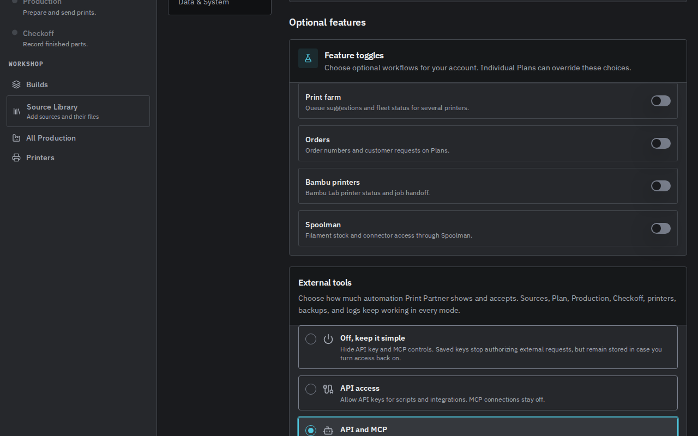
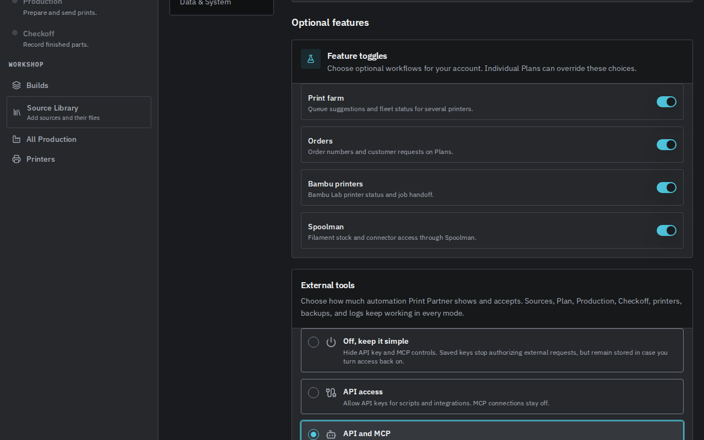
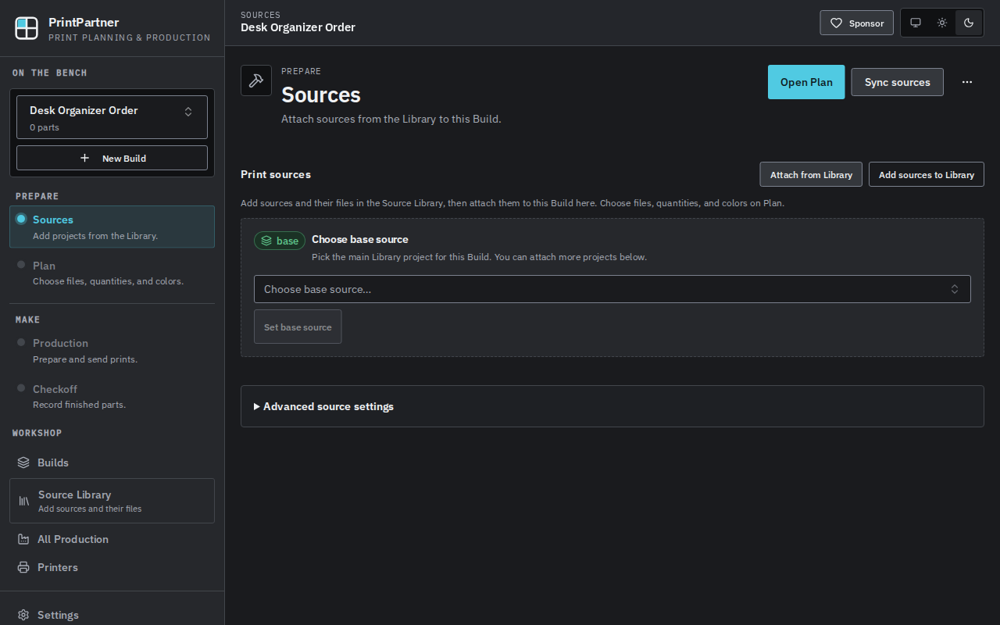
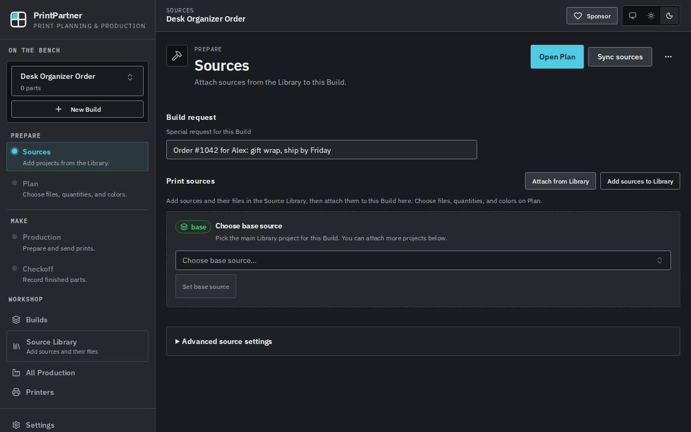
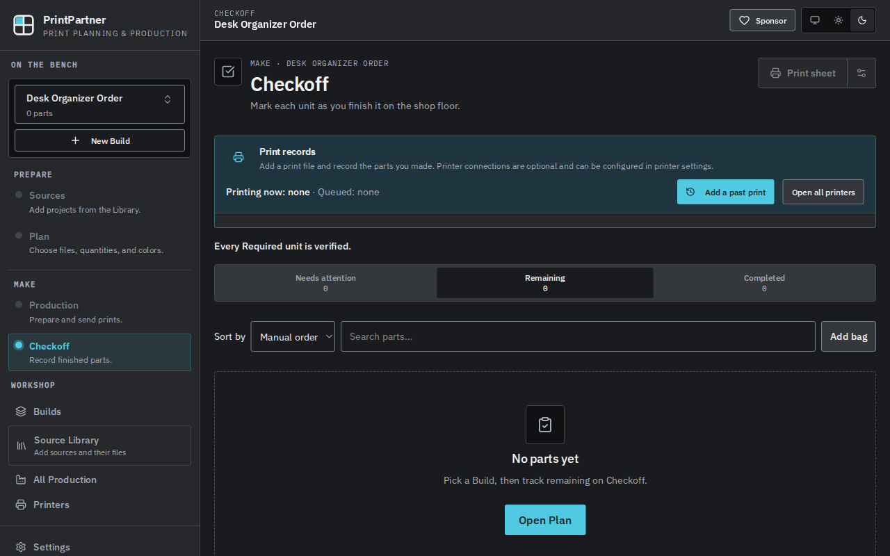
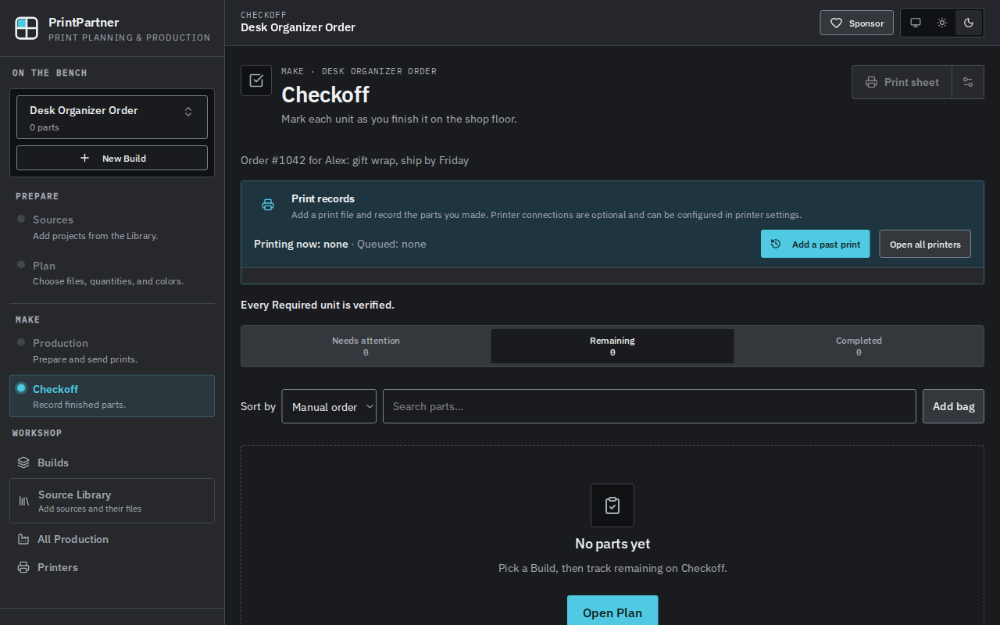

# Orders visibility in Build and Checkoff

With `PP_DESKTOP_REBUILD` set to exactly `1` or `true`, the server advertises
the `tenant_feature_toggles` capability. The web app then shows a Plan's
customer request only when Orders is enabled for that Plan. This applies to:

- the Build request field on Build Sources,
- the customer request in the Build planning card,
- the customer request line on Checkoff.

`useOrdersVisible` reads the Plan's effective features, so a Plan override wins
over the account choice. The request stays hidden while features load, after a
failed read, and for features that belong to another Plan. Revocation hides it
on the next features update. Without the capability, the request shows as
before. The server enforces Orders writes separately, as described in
[Orders admission for Plan edits](gre-498-orders-admission.md). Hiding the
request does not change the stored value.

## Screenshots

The screenshots use a disposable data directory with one Plan that stores a
customer request.

| | Default (all features off) | Fully enabled |
| --- | --- | --- |
| Settings |  |  |
| Build |  |  |
| Checkoff |  |  |

## Tests

With Node 22 and workspace dependencies installed, run from `web/apps/web`:

```sh
npx vitest run src/hooks/useOrdersVisible.test.tsx src/pages/BuildPage.sources.test.tsx
```
