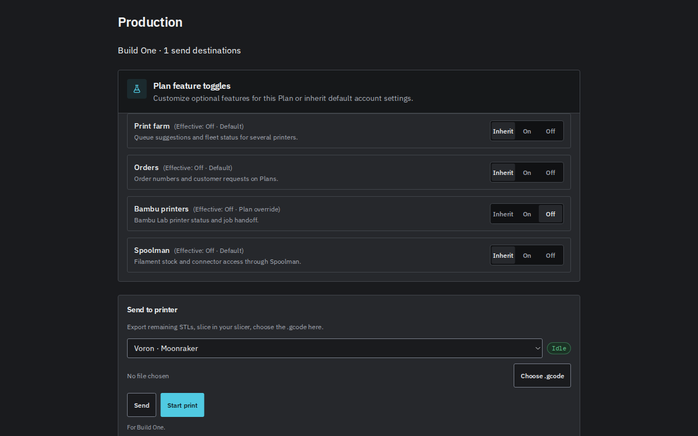
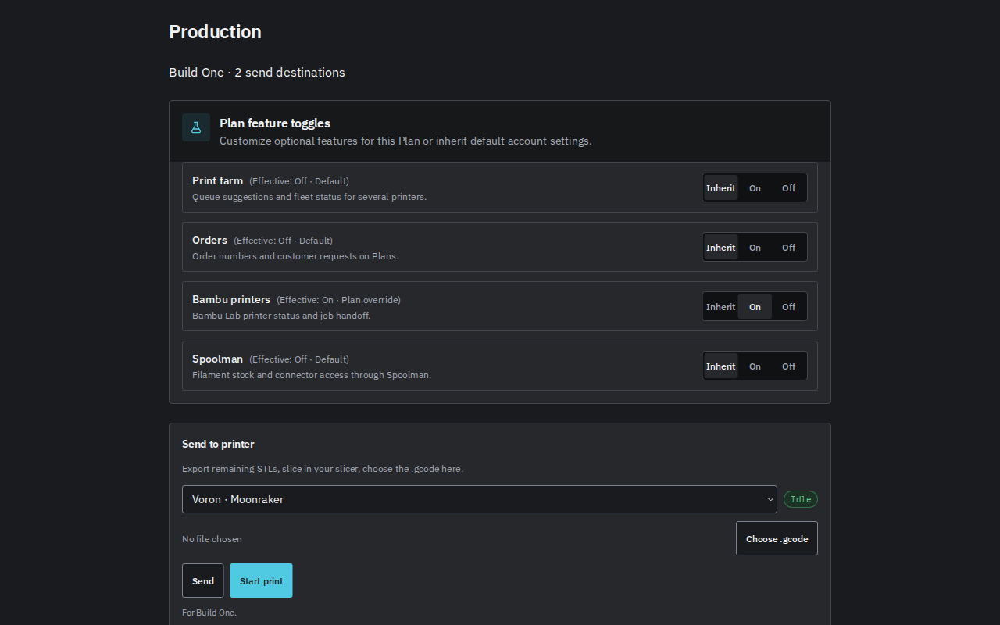
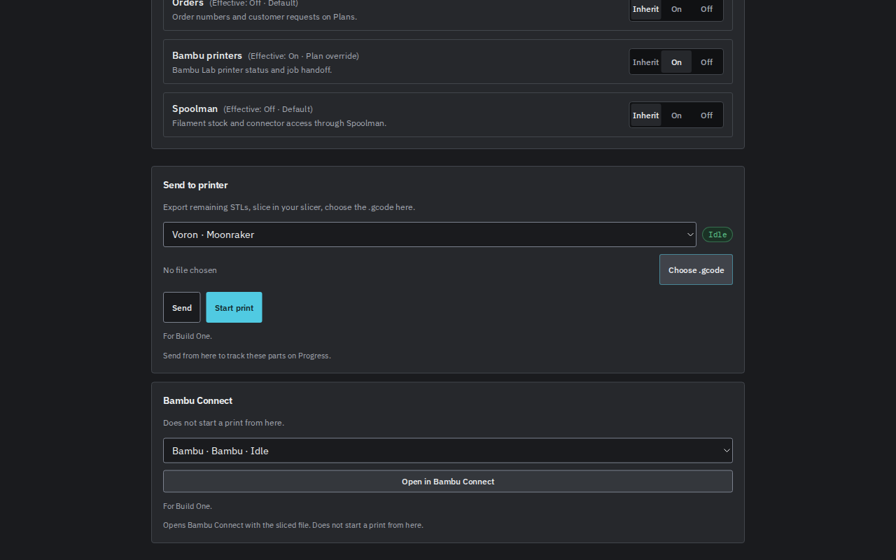

# GRE-498 Bambu Production visibility evidence

Production now uses the selected Plan's effective Bambu choice to show the Connect handoff and count its destination. Bambu status polling uses the account choice because integration inspection is an account-wide operation. Direct-send printers remain available while optional feature data loads or fails.

This is a Refs slice. It does not complete GRE-498. Orders, broader farm visibility, and Plan-aware Spoolman workflows remain follow-up work.

## Model and environment

- Author was Codex gpt-6.1-sol through T3 Code on fleet VM 136.
- Read-only grounding and two design candidates used Codex gpt-6.1-sol.
- The implementation uses the existing server-resolved feature values. No new flag or backend authorization rule was added.
- `PP_DESKTOP_REBUILD` stays off by default. Engines without the feature capability retain legacy behavior and receive no feature-setting requests from this hook.
- Local verification used Node 22.23.3. No physical printer was contacted.

## Design choice

A shared Bambu access hook won over a fleet hook that also owned dispatch. The smaller interface keeps existing fleet partitioning and transport code in place. Its handoff attempt checks the current query cache before dispatch and after asynchronous work. A cache subscription permanently invalidates an attempt when access is revoked, including an off/on change before React rerenders.

The throughput checkpoint kept ownership checks first, ran read-only design work in parallel, and kept all code writes with one author. Existing query caches own feature state. This avoids a second copy of Plan override resolution.

## Deterministic verification

Run from `web/` with Node 22.

```sh
npm run test -w @print-partner/web -- src/components/export/PrinterSendPanel.features.test.tsx src/components/export/PrinterSendPanel.build-isolation.test.tsx src/components/export/PrinterSendPanel.job-recovery.test.tsx src/pages/ExportPage.test.tsx src/components/plan/PlanFeaturesCard.test.tsx
npm run test -w @print-partner/server -- src/routes/bambu-connect-feature-access.test.ts src/routes/bambu-connect-upload-feature-access.test.ts src/routes/jobs-printer-upload-feature-access.test.ts src/routes/printer-send-queue-dispatch-feature-access.test.ts src/services/printer-upload-feature-access.test.ts src/lib/farm-access.test.ts
npm run build -w @print-partner/web
```

The web typecheck, production build, focused ESLint check, and diff whitespace check passed. The focused UI run passed 66 tests. The existing HTTP, MCP, and worker run passed 305 tests. The latter proves selected or stored Plan admission, revocation, corruption, ownership, tenant isolation, and legacy behavior. The global MCP farm tool remains account-scoped and cannot be enabled by a Plan override.

The UI tests cover all four Plan/account combinations, legacy engines without feature requests, loading and errors, cached allowed data followed by a failed refetch, Plan cache updates, Plan switches during file parsing, revocation followed by re-enable, and suppression of late handoff downloads. Existing tests continue to cover direct-send retries and Build isolation.

## Browser verification

Start the web dev server and open `/test/browser/bambu-feature-visibility.html`. The committed fixture renders the real Plan controls, send panel, access hook, fleet counter, and query hooks. Its in-page transport supplies deterministic connector responses and records requested paths. It does not contact a running backend or physical printer. Backend behavior is covered separately by the server suites above.

On the default fixture, the browser showed one direct-send destination, no Bambu handoff, and no Bambu status requests. Moonraker status requests continued.



Clicking **Bambu printers: On** updated the count to two through the real Plan mutation hook. The handoff became available while the account stayed off. Recorded Bambu status requests remained zero.



Opening the fixture with `?plan=1&account=1` enabled both the handoff and Bambu status polling. The Bambu option displayed Idle.



The client can suppress a stale handoff or its later browser effects. Server admission and worker guards remain authoritative for requests already dispatched. Other mounted consumers may independently own status polling outside this Production panel.
