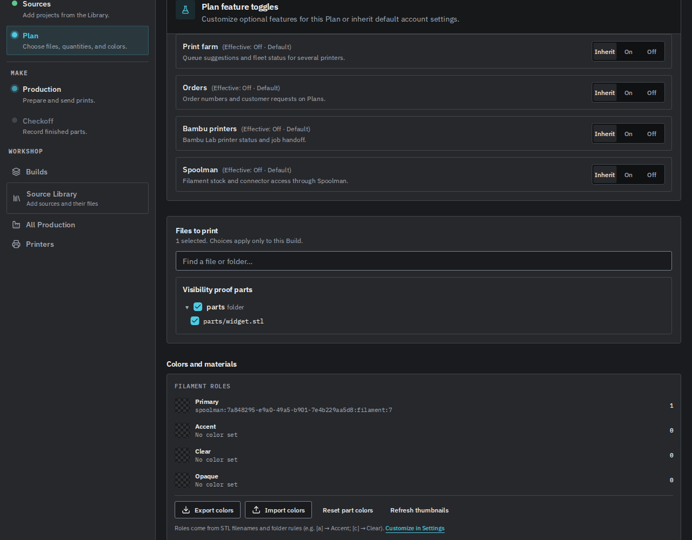
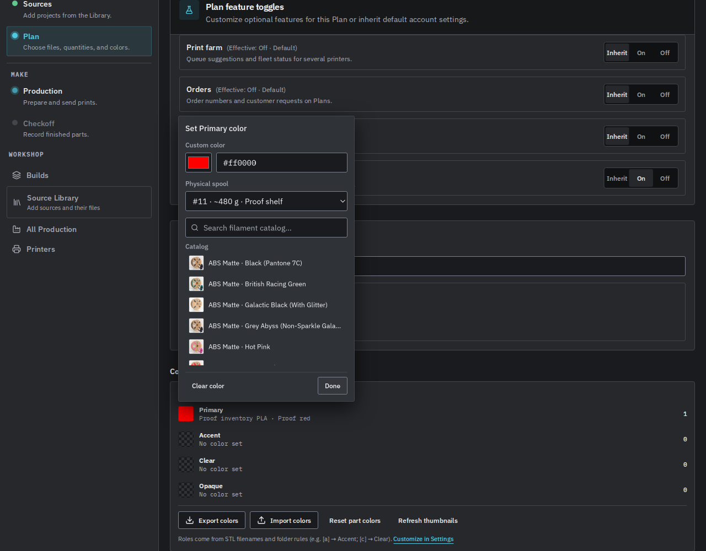
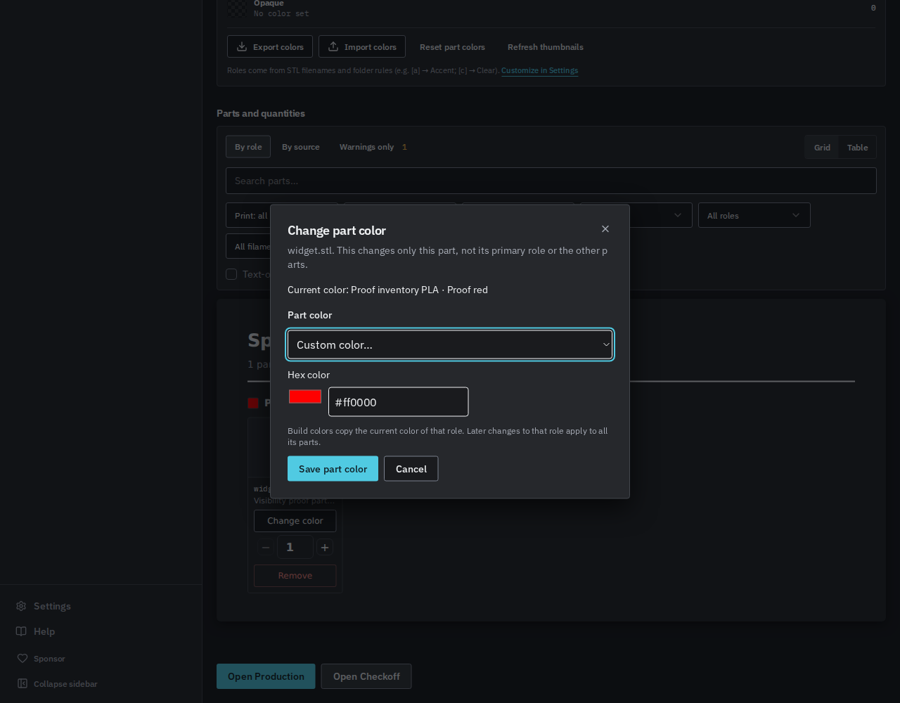

# GRE-498 Plan-aware Spoolman workflows

The selected Plan now governs Spoolman inventory, assignment, Review enrichment, and best-effort deduction. Defaults remain off behind `PP_DESKTOP_REBUILD`. Gate-off engines retain legacy behavior.

Codex gpt-6.1-sol authored the backend, access guards, and final verification through T3 Code on fleet VM 136. Antigravity gemini-3.8-flash-high implemented the UI. Verification used Node 22.23.3, disposable SQLite data, and a local mock Spoolman service. No physical printer or production inventory was contacted.

Explicit Plan scope won over a new inventory facade because it follows the Bambu pattern and keeps feature resolution authoritative. Inventory endpoints validate optional owned `profile_id`. Omission retains account semantics. Client caches separate Plan and account data and mask denied inventory.

The throughput checkpoint ran ownership and base checks first. Backend and frontend had separate file ownership with a fixed HTTP contract. Existing settings and query caches own shared state. Each layer had one writer.

## Verification

Run from `web/` with Node 22.

```sh
npm run test -w @print-partner/server -- src/routes/spoolman-workflow-access.test.ts src/routes/spoolman-feature-access.test.ts src/routes/filament-catalog-feature-access.test.ts src/services/filament-resolve.test.ts src/services/spoolman-deduct.test.ts src/services/farm-filament.test.ts src/assistant/tools.test.ts src/mcp/product-mcp.test.ts
npm run test -w @print-partner/web -- src/components/RoleFilamentPicker.features.test.tsx src/hooks/useSpoolmanWorkflowAccess.test.tsx src/hooks/useSpoolmanEnabled.test.ts src/lib/colorPresets.test.ts src/api/endpoints/filaments.test.ts src/components/review/ReviewPartsSheet.accessibility.test.tsx src/components/review/ReviewPartsSheet.remove.test.tsx
npm run build
```

The independent runs passed 234 backend and 47 frontend tests. The production build, focused ESLint, dead-code check, and diff check passed. Tests cover both HTTP aliases, ownership, corruption, tenant isolation, all account/Plan combinations, legacy behavior, real MCP confirmation, cached access, and revocation across asynchronous work.

The isolated live server preserved 252 bundled colors while off and denied spool reads with `FEATURE_DISABLED`. Plan-on/account-off and both-on returned inventory. Plan-off/account-on remained denied. The browser saved a Spoolman color and selected a 480 g proof spool. Switching off hid inventory choices, preserved the assignment, and kept custom colors and clearing available. The fixture Source has no Git revision; its unrelated sync failure is outside this proof.





Connector configuration remains account-wide. Denied preset imports leave assignments intact. Farm inventory becomes unknown while denied. Deduction checks access before telemetry and every write. Plan-save contracts accept only inclusion and quantity decisions. Broader Orders and farm visibility remain follow-up GRE-498 work.
