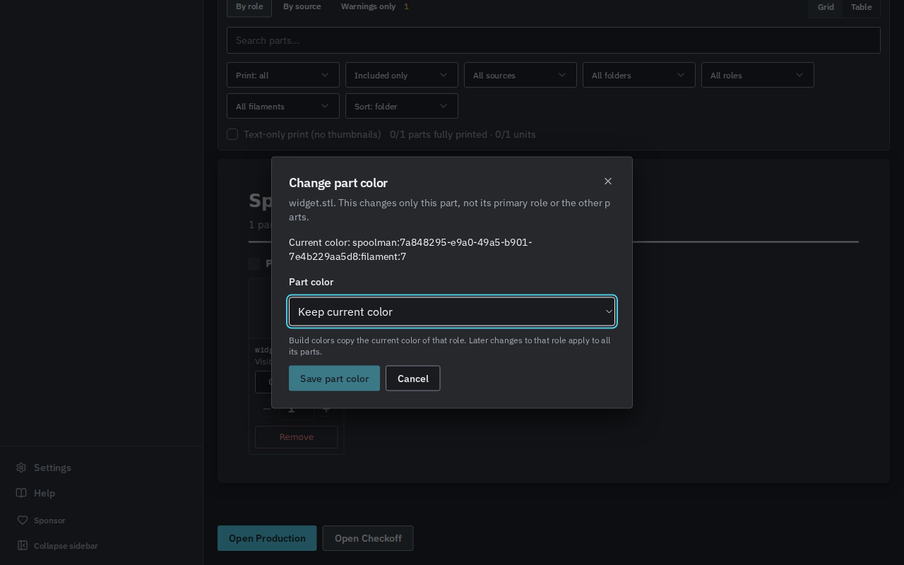

# GRE-498 Plan-aware Spoolman workflows

The selected Plan governs Spoolman inventory, assignment, Review enrichment, and best-effort deduction. Defaults remain off behind exact `PP_DESKTOP_REBUILD=1` or `true`; gate-off engines retain legacy behavior. Explicit owned Plan scope follows the existing Bambu pattern. Settings remain account-wide.

Codex gpt-6.1-sol authored backend/access guards and verification through T3 Code on fleet VM 136. Antigravity gemini-3.8-flash-high authored UI changes. Tests use Node 22.23.3, disposable SQLite, and local mock Spoolman. No production inventory or physical printer was contacted.

## Verification

Run from `web/` with Node 22:

```sh
npm exec -w @print-partner/server -- vitest run src/routes/spoolman-workflow-access.test.ts src/routes/spoolman-feature-access.test.ts src/routes/filament-catalog-feature-access.test.ts src/services/filament-resolve.test.ts src/services/spoolman-deduct.test.ts src/lib/farm-access.test.ts src/db/plan-save.test.ts src/routes/plan-drafts-routes.test.ts
npm exec -w @print-partner/web -- vitest run src/hooks/useSpoolmanWorkflowAccess.test.tsx src/components/RoleFilamentPicker.features.test.tsx src/hooks/useSpoolmanEnabled.test.ts src/lib/colorPresets.test.ts src/api/endpoints/filaments.test.ts src/components/review/ReviewPartsSheet.accessibility.test.tsx src/components/review/ReviewPartsSheet.remove.test.tsx
npm run build
```

Coverage includes both inventory/assignment HTTP aliases, all account/Plan choices, ownership, corruption, tenant isolation, legacy behavior, MCP confirmation, farm unknown inventory, publication rollback, and deduction revocation before writes. Disabled reads preserve bundled/custom data and stored assignments. Plan-draft save has no `/api/v1` alias. Unused role defaults cannot block ordinary assignment.

Mounted-query tests exercise Review, role and catalog caches together across off/on, failed refreshes, cancelled responses, and multiple consumers. Component tests cover Plan switches, imports, dialogs and ordinary colors. The isolated browser preserved 252 bundled colors while off, exposed stock with Plan-on/account-off, selected a 480 g proof spool, and retained clearing/custom colors after revocation. Its fixture Source has no Git revision; the unrelated sync failure is outside this proof.




All 22 CI checks settled successfully at `a406a80a`, including runtime after an earlier unchanged Rust supervisor timeout. Opus could not score: “Claude API rate limit reached. Try again later.” The authorized gpt-6-astra fallback scored that head 7.8/10 and requested dialog/mutation fixes. Those require a fresh exact-head gate. The diff exceeded the original 1.5k-line target; redundant hook tests were removed in favor of combined behavioral coverage. Broader Orders and farm visibility remain follow-up GRE-498 work.

Round-one fixes bind all role-response publication to the captured action scope/generation, sanitize ordinary results without clearing saved references, and refresh discarded optional results. Dialogs resolve live observations from the scoped catalog and retain entered custom hex separately. All seven web suites passed 54 tests; the final dialog/mutation suite passed 11 tests with restoration held pending until fresh data. The retained-dialog screenshot uses the fixture Plan toggle through DOM dispatch while the modal stays open. Fresh exact-head CI and scoring remain required.
