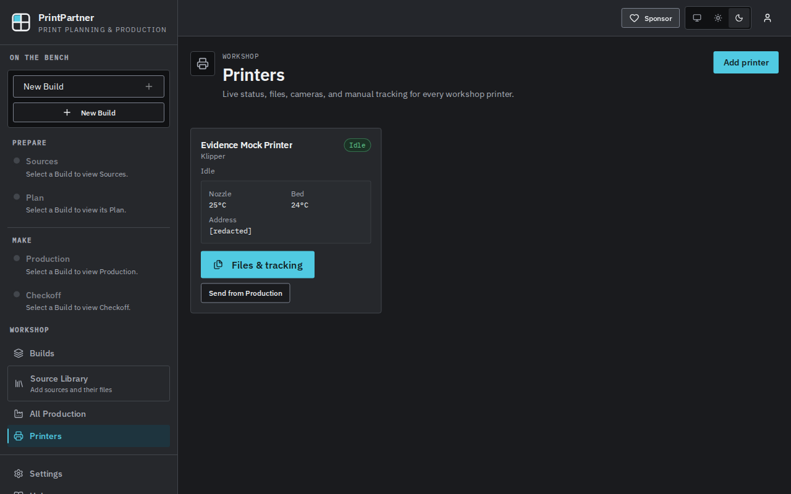

# PR #200 (GRE-335) evidence @ 4b5d708

PASS: fresh real desktop stack (`pp-server` + desktop web UI) built and run from source head `4b5d7080333c6f7456eef770a5b9cac6ce0af480`. Local loopback mock only; no real printer or LAN printer address was contacted. No PR code changes. Evidence branch: `evidence/pr200-4b5d708`.

## Exact build and runtime steps

```bash
git fetch origin && git rev-parse HEAD
gh pr view 200 --json headRefOid
# Both: 4b5d7080333c6f7456eef770a5b9cac6ce0af480
npm --prefix web ci
VITE_PRINT_PARTNER_DESKTOP=1 npm --prefix web run build
python3 rust/scripts/build-desktop-manifest.py --web web --node /opt/agent-fleet/bin/node --output rust/bundle-manifest.json --commit 4b5d7080333c6f7456eef770a5b9cac6ce0af480
cargo build --manifest-path rust/Cargo.toml --locked -p pp-server
python3 evidence/mock_moonraker.py 17125 /tmp/pr200-4b5-mock.log
mktemp -d /tmp/pr200-4b5d708.XXXXXX
# Result assigned to RUN_DIR; temporary data, credentials and cookie jar stay outside git.
rust/target/debug/pp-server --data "$RUN_DIR/data" --web web --node /opt/agent-fleet/bin/node --commit 4b5d7080333c6f7456eef770a5b9cac6ce0af480 --test-credential-file "$RUN_DIR/credential.json"
```

All build commands passed. Node v24.21.0; Rust/Cargo 1.99.0. npm emitted the repository's Node 22 engine warning with Node 24, but installation/build completed. Manifest sha256: `c94997efeb296d0eb1c1944ad84cd6b29dba45562ab53c4562de1bb2ca3b2fab` (1535 measured files, 41822 dependency files, 50 dependency links). Fresh Rust build finished in 1m 05s.

Mock script copied unchanged from `origin/evidence/pr200-7634da3e:evidence/mock_moonraker.py`. It binds only `127.0.0.1:17125`, has no outbound client, and cycles printing → complete → standby every 20 seconds.

1. Opened the one-use bootstrap URL in the T3 collaborative browser. In Settings, entered `Evidence Mock Printer`, selected `Connect to this printer`, and clicked `Add printer` (default Prusa MK4 bed preset).
2. Kept Klipper (Moonraker), replaced the prefilled Base URL with `http://127.0.0.1:17125` **before saving**, and clicked `Save connection`. Its integration configuration has `enabled: true`; no API key was needed. Opened `/printers` and observed printing 43%, bracket.gcode, nozzle 210/215 °C and bed 60/60 °C.
3. Gracefully stopped the launcher with SIGTERM and restarted it on the same temporary data directory, using a new `credential2.json`, to issue a new bootstrap for curl. Each bootstrap was consumed once. Used Python to read the URL directly from the credential file without displaying or committing it:

```python
u = json.loads((run_dir / 'credential2.json').read_text())['bootstrap_url']
subprocess.run(['curl', '--fail', '--silent', '--show-error', '-c', str(run_dir / 'cookies.txt'), '-o', '/dev/null', u], check=True)
```

The launcher origin for this run was `http://127.0.0.1:45391`. An attempted browser transfer of the curl session could not replace the existing HttpOnly cookie; the browser was moved away from the app. The curl session remained valid, and no authentication configuration was changed.

```bash
curl --fail --silent --show-error -b "$RUN_DIR/cookies.txt" -H 'Origin: http://127.0.0.1:45391' http://127.0.0.1:45391/api/v1/integrations
curl --fail --silent --show-error -b "$RUN_DIR/cookies.txt" -H 'Origin: http://127.0.0.1:45391' http://127.0.0.1:45391/api/v1/integrations/4e30a6c6-58a7-4ac7-9ec5-26ab6e3a7117/status > evidence/status.json
python3 evidence/db_snapshot.py "$RUN_DIR/data" /tmp/pr200-4b5-mock.log > evidence/db-before.json
# Waited at least 20 seconds; actual snapshot interval below.
python3 evidence/db_snapshot.py "$RUN_DIR/data" /tmp/pr200-4b5-mock.log > evidence/db-after.json
curl --fail --silent --show-error -b "$RUN_DIR/cookies.txt" -H 'Origin: http://127.0.0.1:45391' http://127.0.0.1:45391/api/v1/integrations/4e30a6c6-58a7-4ac7-9ec5-26ab6e3a7117/status > evidence/status-after.json
```

## Rust watcher status through the gateway

Printing response (exact loopback address, no credentials):

```json
{"state":"printing","progress":43.0,"filename":"bracket.gcode","message":"Printing bracket.gcode","ip_address":"127.0.0.1","nozzle_temperature_c":210.2,"nozzle_target_c":215.0,"bed_temperature_c":59.8,"bed_target_c":60.0}
```

Later idle response:

```json
{"state":"idle","message":"Idle","ip_address":"127.0.0.1","nozzle_temperature_c":25.0,"nozzle_target_c":0.0,"bed_temperature_c":24.0,"bed_target_c":0.0}
```

Neither response contains `uptime_seconds`. The mock request log shows status queries every approximately 2 seconds. `/api/v1/integrations/<id>/status` is the gateway-owned Rust cache route at this head; no Node direct-status endpoint was used.

## DB before/after, no checkpoint

Window: `2026-10-11T13:14:30.628527+00:00` to `2026-10-11T13:15:01.486892+00:00` (30.858 s). Mock query count 27 → 42: **15 watcher cycles**. The server stayed running throughout this window; no integration changes, admin actions, UI writes, or app UI client were active. Polling continued in the background.

The read-only receipt script hashes the DB and WAL, reads every table via `sqlite3.connect(file_uri + '?mode=ro', uri=True)`, and performs no checkpoint. The volatile SHM file is not hashed. The WAL existed throughout.

| File | BEFORE sha256 | AFTER sha256 | Bytes before/after |
|---|---|---|---|
| `print-partner.db` | `6231a25b084f84d1f67cc5984be22913c1bcfe93d99f54af521c627c0fb5fed6` | `6231a25b084f84d1f67cc5984be22913c1bcfe93d99f54af521c627c0fb5fed6` | 606208 / 606208 |
| `print-partner.db-wal` | `8f07f46c7f9880485c8ca2db57a8f113b8b1896e4f9529727a3993407a099b78` | `8f07f46c7f9880485c8ca2db57a8f113b8b1896e4f9529727a3993407a099b78` | 12392 / 12392 |

All table counts identical: app_settings 4, filament_profiles 4, printer_profiles 2, process_profiles 6, slicer_instances 3, sqlite_sequence 3; every other table 0. Full table-by-table snapshots: [before](db-before.json), [after](db-after.json). In particular Checkoff/progress, upload/source and queued-send related persistent rows remained unchanged.

Full mock request log: [mock-requests.log](mock-requests.log). Across setup, measurement and capture it contains 67 GET /printer/objects/query requests and 3 GET /server/info requests (explicit browser availability/navigation probes by the evidence runner). The watcher requests were only /printer/objects/query; the mock performed no outbound traffic.

## Screenshot @ head 4b5d708



Captured after the DB window: gracefully restarted the same launcher/data directory with `credential3.json`, consumed its new bootstrap in the browser, opened `/printers`, and verified zero Uptime `dt` elements. Used T3 collaborative browser capture (`preview_snapshot`, 1280×800 app viewport) instead of a whole-display capture to omit browser chrome. Immediately before capture, replaced only the Address `dd` text with `[redacted]` and removed its title in the live DOM. No status field, Uptime condition, app source, or DB was edited. PNG inspected: app UI only, no terminal, hostnames/IPs, secrets or local paths. Original screenshot copied unchanged into the evidence branch.

PNG sha256: `3887324ccc09aa9cd0025afec98e7638b69f4d2e59c170f9b94a72ebc4df6db6`.

Both launcher and mock stopped after capture. Temporary credentials, cookies, DB, generated assets and manifest are not committed.

## Model/harness and author search

Original author: unknown/undisclosed. Brief search of T3 thread titles/content for GRE-335, local Codex logs matching GRE-335/#200/Moonraker, and GRE-335 git commit trailers found later merger/review work by gpt-6.1-sol and prior evidence by Claude Haiku 5.5; none established a non-Cursor original implementation author model. The implementation commits have no model trailer. Evidence runner: gpt-6.1-sol (medium reasoning), Codex harness in T3 Code. No delegation or Grok used.

Exemption: none
